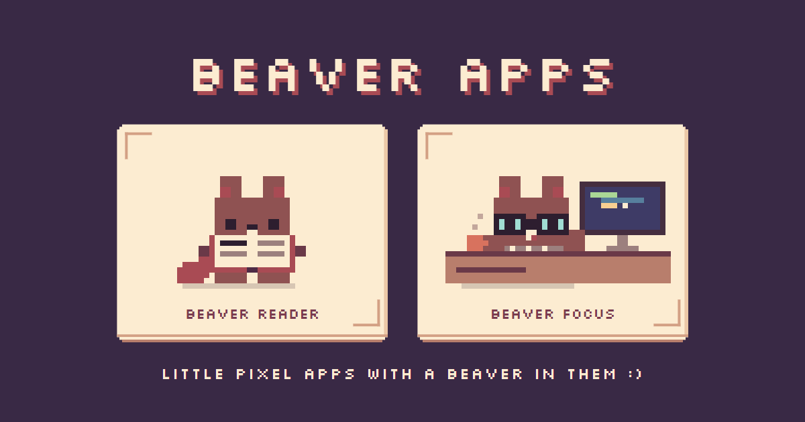
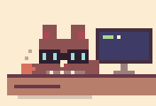

  

<h1 align="center">Beaver Apps</h1>

<b><a href="https://beaver-apps.github.io/">beaver-apps.github.io</a></b>

Little pixel apps with a beaver in them :)

---

## Hi, I'm the beaver

I have two jobs, and you can have both of them for free. No account, they work offline, and your stuff stays
on your own device.

| | |
|---|---|
|  | **[Beaver Reader](https://beaver-apps.github.io/reader/)** A cozy EPUB and PDF reader with a pixel bookcase. I climb it, dust it and read along with you. ([repo](https://github.com/beaver-apps/reader)) |
|  | **[Beaver Focus](https://beaver-apps.github.io/focus/)** A pomodoro timer with a lo-fi radio. I work while you work, take breaks with you and nap at night. ([repo](https://github.com/beaver-apps/focus)) |

Install either one to your home screen or desktop from the browser and it works like a normal app. The page has a
picture-by-picture guide for iPhone and iPad, Android and computers (it opens on the right one for your device).

## About this repo

This repo is the little front page at https://beaver-apps.github.io/ that links to both apps (each app has its own
repo with its ready-to-use files). Share the front page if you want to show someone the whole set :)

Made with acorns by [BwunLevain](https://github.com/BwunLevain) · part of [Beaver Apps](https://github.com/beaver-apps) on GitHub.
